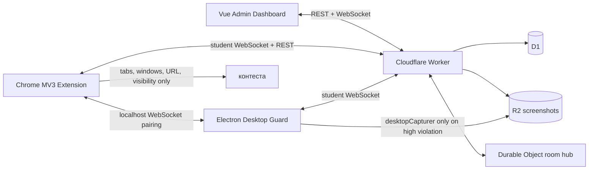

# KOSH!RME

Desktop **0.1.8** проверяет захват экрана при открытии на macOS и Windows. Windows использует заранее собранный помощник с диагностикой Win32. Для публикации установщик, приложение и помощник проходят проверку подписи. [Сборка и проверка Windows](docs/WINDOWS.md)

**Обновление 12 ноября 2026:** Mac Desktop **0.1.7** и Chrome Extension **0.3.1** подключаются только автоматически из контеста fizmat.win: кнопок сопряжения и копирования кодов нет. На Mac перед готовностью после согласия закрываются остальные пользовательские приложения, кроме Chrome, Коширме и системных служб. Приложения с несохранённой работой не завершаются принудительно: начало блокируется до их закрытия. Во время активного экзамена повторно запущенные приложения также закрываются. Закрытие desktop или расширения завершает попытку этого ученика на сервере, сохраняя решения; повторный вход не отменяет завершение. При тихой потере сети действует heartbeat 12 секунд и watchdog каждые 2 секунды. Исходная Windows-сборка остаётся 0.1.6; новая функция закрытия программ реализована для Mac.

Сборка Mac: `APPLE_KEYCHAIN_PROFILE=koshirme-notary npm run dist:mac --workspace @koshirme/student-desktop` (профиль должен быть настроен в Keychain владельца). В Git нет ключей или паролей подписи. Документация нового выпуска: [docs/MAC_017.md](docs/MAC_017.md).


KOSH!RME — система мониторинга контеста для учителей. Учитель заранее создаёт комнату, задаёт до трёх разрешённых страниц, ученики входят по случайному четырёхзначному коду и ждут общего запуска. После начала расширение разрешает переходы только между заданными HTTPS-страницами, фиксирует нарушения и возвращает ученика в Contest. При нарушении Desktop Guard показывает красный экран; при серьёзном нарушении он один раз делает JPEG screenshot всего экрана и отправляет его учителю. Интерфейсы доступны на русском и казахском языках.

Адрес платформы: **https://koshirme.stream**

Desktop **0.1.5** исправляет автоматический возврат ученика в Chrome. После захвата экранного доказательства приложение фокусирует контест и активирует Chrome средствами ОС; ошибка или cooldown снимка не выключают возврат. При закрытии вкладки контест создаётся заново. После полного закрытия браузера Chrome запускается с адресом контеста через 2 секунды, один раз за непрерывный разрыв связи и не чаще раза за 30 секунд при переподключениях. После Pause/Finish/Delete восстановление отменяется. Ошибки возврата отображаются в Desktop. Для этого поведения установите новое приложение: изменение сайта само по себе не обновляет установленный EXE/DMG. Расширение 0.2.8 из магазина и подготовленное 0.2.9 совместимы; выпуск расширения для этого исправления не нужен.

[Здесь можете создать контест](https://fizmat.win).

Домен настраивается как Cloudflare Worker Custom Domain в `apps/cloudflare/wrangler.jsonc`. Перед публикацией зона `koshirme.stream` должна быть добавлена в тот же Cloudflare account, а её nameservers у регистратора должны указывать на Cloudflare. `npm run deploy --workspace @koshirme/cloudflare` привяжет домен к Worker. Старый адрес `workers.dev` остаётся доступным для совместимости с ранее установленными приложениями. Результаты текущей проверки: [docs/VERIFICATION.md](docs/VERIFICATION.md).

В форме комнаты все три поля принимают полные HTTPS-ссылки любой платформы. Первый адрес обязателен; остальные два — по желанию. Параметры запроса и фрагменты удаляются, ссылки с паролями и нестандартными портами отклоняются.

Проект не использует камеру, микрофон, gaze tracking, распознавание лиц, AI-анализ, keylogger или постоянную запись экрана. Он не читает содержимое страницы, пароли, keyboard input, cookies и историю браузера. В Desktop 0.1.7 и Extension 0.3.1 ручное сопряжение и clipboard-подключение удалены. Приложение получает одноразовый билет через сайт; разрешения чтения буфера обмена у нового расширения нет. Monitoring работает только внутри активной exam session и прекращается после **Finish room** либо по истечении ограниченного offline grace period.

## Важное ограничение

Обычные Chrome Extension и Electron-приложение не могут безопасно гарантировать блокировку всех остальных программ macOS/Windows. Текущий exam mode:

- блокирует новые main-frame переходы Chrome вне одного–трёх разрешённых HTTPS-адресов;
- замечает другую вкладку, новое окно/вкладку и потерю фокуса Chrome;
- возвращает фокус на вкладку Contest после нарушения;
- показывает красный полноэкранный warning поверх экранов;
- уведомляет teacher dashboard в реальном времени;
- делает screenshot только для high-severity нарушения.

Для OS kiosk mode на Windows нужны настройка отдельной экзаменационной учётной записи и Assigned Access/Shell Launcher. На macOS нужен поддерживающий Apple Assessment Mode клиент с одобренным Apple entitlement; MDM для самого Assessment Mode не обязателен. Desktop 0.1.7 на Mac штатно закрывает пользовательские GUI-приложения после согласия; системные службы не затрагиваются. Принудительного завершения, обхода системных permissions и tamper-proof kiosk нет.

## Архитектура



Cloud deployment использует один Cloudflare Worker:

| Компонент          | Технологии                                              | Назначение                                                              |
| ------------------ | ------------------------------------------------------- | ----------------------------------------------------------------------- |
| Admin Web          | Vue 3, Vite, TypeScript strict, PrimeVue, Pinia, Router | Rooms, teachers, live students, timeline, screenshot Dialog             |
| Cloud API          | TypeScript Worker                                       | Auth, REST, risk score, upload authorization, static assets             |
| Realtime           | Durable Objects + hibernating WebSockets                | Admin/student sockets, heartbeat watchdog, broadcasts                   |
| Database           | Cloudflare D1                                           | Users, rooms, sessions, violations                                      |
| Screenshot storage | Cloudflare R2                                           | Private JPEG objects, read only through authorized API                  |
| Extension          | Manifest V3, TypeScript                                 | Chrome/tab/focus events, URL allowlist, event delivery                  |
| Desktop            | Electron, TypeScript                                    | Consent, localhost pairing, permission check, JPEG capture, red warning |

Для локальной разработки сохранён альтернативный FastAPI backend с PostgreSQL, SQLAlchemy и Alembic. Клиентский протокол одинаков для локального и Cloudflare backend.

## Структура monorepo

```text
examguard/
├── apps/
│   ├── admin-web/          # Vue teacher/admin dashboard
│   ├── backend/            # FastAPI + PostgreSQL local/reference backend
│   ├── cloudflare/         # production Worker + D1 migrations + Durable Object
│   ├── chrome-extension/   # Manifest V3 extension
│   └── student-desktop/    # Electron Guard
├── packages/
│   └── protocol/           # shared events, DTO and URL policy
├── tests/
│   ├── e2e/                # Playwright + real MV3/Electron flows
│   └── cloudflare-smoke.mjs
├── docker-compose.yml
├── .env.example
└── README.md
```

## Требования

- Node.js 22.12+ и npm.
- Google Chrome 120+.
- macOS 13+ или Windows 10/11 для Desktop Guard.
- Docker Desktop для локального FastAPI/PostgreSQL варианта.
- Python 3.12 для backend без Docker.
- Cloudflare account + Wrangler только для повторного deployment.
- На macOS ученик вручную разрешает Screen Recording; KOSH!RME не обходит permission.

## Установка Node.js

Скачайте LTS с https://nodejs.org. На macOS также можно использовать Homebrew:

```bash
brew install node@24
node --version
npm --version
```

На Windows установите официальный `.msi`, откройте новый PowerShell и проверьте те же команды.

Из корня проекта:

```bash
npm ci
```

## Установка Python 3.12

Python не нужен для Cloudflare production или запуска Desktop/Extension. Он нужен только для локального FastAPI backend.

macOS:

```bash
brew install python@3.12
python3.12 --version
```

Windows:

```powershell
py -3.12 --version
```

## Быстрый локальный запуск

```bash
cp .env.example .env
npm ci
docker compose up --build
```

Команда поднимает PostgreSQL и FastAPI на `http://localhost:8000`. Admin с Compose profile:

```bash
docker compose --profile admin up --build
```

Либо Vue в dev mode:

```bash
npm run dev:admin
```

Dashboard откроется на `http://localhost:5173`. Локальный legacy token допускается только при `ALLOW_LEGACY_ADMIN=true`; по умолчанию production-style login обязателен. Создать первого локального администратора:

```bash
cd apps/backend
python3.12 -m app.bootstrap_admin
```

Скрипт запрашивает пароль интерактивно и не пишет plaintext в файлы.

## PostgreSQL и FastAPI отдельно

```bash
docker compose up -d postgres
cd apps/backend
python3.12 -m venv .venv
source .venv/bin/activate
pip install -r requirements.lock
pip install -e '.[dev]' -c requirements.lock
alembic upgrade head
python -m app.bootstrap_admin
uvicorn app.main:app --reload --host 0.0.0.0 --port 8000
```

PowerShell:

```powershell
cd apps/backend
py -3.12 -m venv .venv
.venv\Scripts\python -m pip install -r requirements.lock
.venv\Scripts\python -m pip install -e ".[dev]" -c requirements.lock
.venv\Scripts\alembic upgrade head
.venv\Scripts\python -m app.bootstrap_admin
.venv\Scripts\uvicorn app.main:app --reload --host 0.0.0.0 --port 8000
```

Параметры локальной БД по умолчанию:

```text
host: localhost
port: 5432
database: examguard
user: examguard
password: examguard_local
```

`docker compose down` сохраняет volumes. Не добавляйте `-v`, если данные и screenshots должны остаться.

## Admin Web

```bash
npm run dev --workspace @koshirme/admin-web
npm run build --workspace @koshirme/admin-web
```

В development API по умолчанию `http://localhost:8000`. Override:

```dotenv
VITE_API_URL=http://192.168.1.10:8000
```

В production build без `VITE_API_URL` dashboard автоматически использует свой origin, то есть опубликованный Cloudflare Worker.

### Роли

- `admin` видит все комнаты и страницу **Teachers**;
- `admin` создаёт и отключает teacher accounts;
- `teacher` видит и управляет только своими комнатами;
- отключение teacher немедленно отзывает его login sessions.

## Chrome Extension

Сборка:

```bash
npm run build --workspace @koshirme/chrome-extension
```

Установка:

1. Откройте `chrome://extensions`.
2. Включите **Developer mode**.
3. Нажмите **Load unpacked**.
4. Выберите `apps/chrome-extension/dist`.
5. Закрепите KOSH!RME в toolbar.

Готовый архив: [Көшірме Chrome 0.3.0](https://koshirme.stream/downloads/koshirme-chrome-extension-0.3.0.zip). Распакуйте его и выберите полученную папку через **Load unpacked**.

После каждого изменения расширения повторите build, нажмите **Reload** на странице extensions и обновите открытую вкладку контеста.

Extension использует `tabs`, `storage`, `alarms`, `declarativeNetRequest` и `scripting`. Content script работает на HTTPS-страницах; ограничения включаются только для разрешённых адресов активной сессии. Опциональное `clipboardRead` запрашивается после явного нажатия кнопки подключения.

## Electron Desktop Guard

### Установка на macOS

Опубликованный ранее `KOSHIRME-0.1.2-arm64.dmg` не подходит для установки на другие Mac: приложение в нём не имеет действительной подписи Developer ID и macOS может показать «is damaged and can’t be opened». Не раздавайте этот DMG ученикам. Доступен [подписанный и нотарифицированный DMG 0.1.6 для Apple Silicon](https://koshirme.stream/downloads/KOSHIRME-0.1.6-arm64.dmg) (M1 и новее). Откройте DMG, перетащите KOSH!RME в **Applications**, затем выполните Screen Recording permission из раздела ниже. Для Intel Mac отдельная сборка сейчас не выпускается.

Доступен [комплект для сборки Windows EXE 0.1.6](https://koshirme.stream/downloads/KOSHIRME-0.1.6-Windows-source.zip). Сборку и проверку EXE выполняйте на Windows-ПК. Установка и запуск на реальном Windows требуют отдельной проверки. [Публичная инструкция с реальными снимками](https://koshirme.stream/guide.html) содержит шаги для учителя и ученика, ссылки на сайты и контакты.

Development:

```bash
npm run dev:desktop
```

Production backend и локальный канал связи встроены в сборку и не показываются ученику. Для локальной разработки backend можно переопределить переменной `KOSHIRME_BACKEND_URL`; в production-интерфейсе это поле отсутствует. Случайный восьмисимвольный pairing code связывает только Desktop и Extension на этом компьютере. После Join он автоматически копируется, а popup может вставить и применить его одним явным нажатием. При отказе в clipboard permission доступен ручной ввод с подсказкой «Введите код из приложения». Код сохраняется локально, поэтому следующие подключения выполняются автоматически. Это не четырёхзначный room code.

### macOS Screen Recording

Если permission отсутствует, System Check показывает инструкцию. Откройте:

```text
System Settings → Privacy & Security → Screen Recording
```

Разрешите KOSH!RME/Electron, полностью перезапустите Desktop Guard и снова выполните System Check. Приложение не нажимает разрешение за пользователя и не пытается его обходить.

### Сборка macOS

Нужны членство в Apple Developer Program, сертификат **Developer ID Application** в Keychain (или `CSC_LINK` с `.p12`) и данные для Apple notarization. Сертификат **Apple Development** для распространения не подходит. Например, задайте `APPLE_ID`, `APPLE_APP_SPECIFIC_PASSWORD` и `APPLE_TEAM_ID` через переменные окружения. Также поддерживаются `APPLE_API_KEY` + `APPLE_API_KEY_ID` + `APPLE_API_ISSUER` и `APPLE_KEYCHAIN_PROFILE`. Не записывайте пароли и ключи в репозиторий.

```bash
cd apps/student-desktop
APPLE_KEYCHAIN_PROFILE=koshirme-notary npm run dist:mac
```

Команда проверяет наличие сертификата и данных notarization, затем собирает ARM64 DMG. После сборки она проверяет подпись Developer ID, Gatekeeper, прикреплённый билет notarization и целостность DMG, выводит SHA-256. Публикуйте только файл, прошедший все проверки. После загрузки на сайт скачайте его обратно и сравните SHA-256. На другом Mac проверьте установку из скачанного DMG. Сборку для Intel Mac этот сценарий не создаёт.

Если на другом Mac появляется сообщение «damaged», не удаляйте атрибут quarantine и не отключайте Gatekeeper как обычный способ установки: сначала проверьте SHA-256 скачанного файла и получите новую подписанную сборку. Для диагностики локального DMG используйте `hdiutil verify /путь/к/файлу.dmg`; целый DMG всё равно может содержать приложение с недействительной подписью.

### Windows: запустить и собрать новый EXE 0.1.5

Полная пошаговая инструкция: [docs/WINDOWS.md](docs/WINDOWS.md). Подготовленный архив исходников: `apps/student-desktop/release/KOSHIRME-0.1.5-Windows-source.zip`. Распакуйте его на Windows x64, установите Node.js 24 LTS x64 и из корня `examguard` выполните:

```powershell
powershell.exe -NoProfile -ExecutionPolicy Bypass -File .\apps\student-desktop\scripts\build-windows.ps1
```

Скрипт заново устанавливает зависимости именно на Windows, проверяет TypeScript и тесты, собирает installer `apps\student-desktop\release\KOSHIRME-0.1.5-x64.exe`, ZIP расширения 0.2.9 и SHA-256 обоих файлов. Он останавливается при ошибке любой команды и берёт версию из `package.json`.

Для предварительного запуска без installer:

```powershell
npm.cmd ci
npm.cmd run dev:desktop
```

Desktop 0.1.5 подключается к опубликованному backend и совместим с расширением 0.2.8. Пока Chrome Web Store проверяет 0.2.9, оставьте установленное расширение из магазина; не устанавливайте вторую копию в тот же профиль. Python, Docker и локальный backend для запуска Desktop не нужны.

## Сценарий экзамена

### 1. Administrator

1. Войдите в dashboard под admin.
2. При первом входе нажмите **Password** и замените временный пароль.
3. Откройте **Teachers**.
4. Создайте teacher: имя, email и временный пароль минимум из 6 символов.
5. Безопасно передайте пароль учителю вне публичного чата; teacher также меняет его кнопкой **Password**.

### 2. Teacher

1. Откройте **Комнаты** → **Создать комнату**.
2. Введите название и от одного до трёх HTTPS URL контеста.
3. Получите случайный четырёхзначный code, например `4821`.
4. Передайте code ученикам.
5. Дождитесь статуса **Ready** у учеников.
6. Нажмите **Начать мониторинг** — monitoring активируется у всех готовых учеников одновременно.
7. При необходимости используйте **Пауза** и **Продолжить мониторинг**.
8. После экзамена нажмите **Завершить комнату**. Завершённая комната не перезапускается.

### 3. Student

1. Запустите Desktop Guard.
2. До входа в комнату разрешите приложению **Запись экрана и системного аудио**. На macOS приложение само покажет системный запрос или откроет нужный раздел настроек; после изменения разрешения перезапустите KOSH!RME. Микрофон, камера и геолокация не запрашиваются, потому что приложение их не использует.
3. Введите имя и четырёхзначный код комнаты; сервер настроен внутри приложения.
4. Нажмите **Войти в комнату**.
5. Откройте popup расширения и нажмите **Вставить код и подключить** — Desktop уже скопировал pairing code. Если Chrome не разрешил вставку, введите показанный в Desktop 8-символьный код вручную.
6. Дождитесь зелёных проверок соединения и расширения.
7. Подтвердите видимое согласие и нажмите **Ready for exam**.
8. Desktop откроет/сфокусирует Contest и покажет **READY — WAITING FOR TEACHER**.
9. После teacher start появится **MONITORING ACTIVE**.

## Events и risk score

| Event                        | Severity | Risk |
| ---------------------------- | -------- | ---: |
| `PAGE_HIDDEN`                | medium   |   +5 |
| `NEW_TAB`                    | medium   |  +10 |
| `TAB_CHANGED`                | high     |  +20 |
| `GOOGLE_LENS_ATTEMPT`        | high     |   +0 |
| `BROWSER_UI_ATTEMPT`         | high     |  +15 |
| `CHROME_FOCUS_LOST`          | high     |  +25 |
| `DESKTOP_GUARD_DISCONNECTED` | high     |  +30 |
| `STUDENT_DISCONNECTED`       | high     |  +30 |
| `RETURN_TO_EXAM`             | info     |   +0 |

Risk ограничен 100 и является индикатором для проверки учителем, а не автоматическим доказательством нарушения.

`CHROME_FOCUS_LOST` означает «Окно экзамена потеряло фокус»: это также покрывает переход в другой профиль Chrome. Расширение не видит окна чужого профиля и не определяет, какой именно профиль или приложение открыто. Панель учителя показывает пояснение и снимок события. Для ограничения существующих профилей на школьных компьютерах подготовьте политики одного Google-аккаунта: `node scripts/prepare-exam-chrome-policy.mjs --email student@school.kz --out exam-policy-student`. Установка, условия и проверка описаны в [enterprise-policy/README.md](enterprise-policy/README.md). Запрет добавления новых профилей сам по себе не запрещает открывать старые.

Во время мониторинга расширение перехватывает правую кнопку на `pointerdown`, `mousedown`, `mouseup` и `contextmenu`, блокирует контекстное меню на всех разрешённых HTTPS-сайтах и во всех их iframe, а также создаёт событие `GOOGLE_LENS_ATTEMPT` при правом клике, клавише Menu или `Shift+F10`. Потеря фокуса страницы при сохранении активной экзаменационной вкладки фиксируется как `BROWSER_UI_ATTEMPT`: это покрывает попытки открыть Lens, Gemini, адресную строку или другую панель Chrome. Если вкладка была открыта до загрузки/обновления распакованного расширения, защитный скрипт внедряется в неё автоматически. Дополнительное dynamic network rule блокирует запросы к `lens.google.com`. Для управляемых экзаменационных компьютеров используйте готовые шаблоны из [`enterprise-policy/`](enterprise-policy/README.md): они отключают встроенные Gemini/Lens/AI Mode и запрещают все расширения, кроме принудительно установленного KOSH!RME.

High events запрашивают screenshot, кроме случаев, когда capture технически невозможен (`DESKTOP_GUARD_DISCONNECTED`, `STUDENT_DISCONNECTED`). Screenshot разрешён сервером только для своего student token, только пока room активна и не позднее 30 секунд после события.

## Screenshot flow

1. Extension создаёт high event с UUID.
2. Backend сохраняет событие и немедленно рассылает его dashboard.
3. После server acknowledgement Extension посылает Desktop `capture_screen`.
4. Electron `desktopCapturer` получает все доступные displays.
5. Изображение ограничивается размером, кодируется JPEG quality 75 и не сохраняется на диск ученика.
6. Backend проверяет active session, event ownership, тип события, MIME, размер до 5 MiB и JPEG signature.
7. Cloud deployment кладёт UUID filename в private R2; local FastAPI использует storage interface и `uploads/screenshots`.
8. Dashboard получает `screenshot_updated` через WebSocket и открывает файл только через авторизованный endpoint.

## Heartbeat и отключение

Extension и Desktop отправляют heartbeat каждые 5 секунд. Durable Object хранит hibernating WebSockets и запускает alarm watchdog. Если extension heartbeat отсутствует более 15 секунд, student становится offline и при активном monitoring создаётся `STUDENT_DISCONNECTED`. Desktop disconnect отдельно определяется расширением и создаёт `DESKTOP_GUARD_DISCONNECTED`.

При кратком обрыве backend-связи локальная блокировка и фиксация нарушений продолжаются до 2 минут. Extension хранит до 500 событий в `chrome.storage.local`, повторяет подключение с увеличивающейся задержкой и досылает события по UUID после восстановления сети без двойного начисления risk. Для события, произошедшего без актуального server lease, screenshot помечается unavailable: поздний кадр не выдаётся за снимок момента нарушения. Ответ сервера о Pause/Finish имеет приоритет и выключает мониторинг сразу после получения; без связи локальный grace period ограничивает продолжительность сбора.

## Cloudflare deployment

Production использует:

- Worker `examguard`;
- D1 database `examguard` в APAC;
- R2 bucket `examguard-screenshots` Standard;
- Durable Object class `ExamRoom`;
- Worker Static Assets для Vue build.

Повторный deployment:

```bash
npx wrangler login
npm ci
npm run build --workspace @koshirme/admin-web
npm run typecheck --workspace @koshirme/cloudflare
cd apps/cloudflare
npx wrangler d1 migrations apply examguard --remote
npx wrangler deploy
```

Создание ресурсов в новом аккаунте:

```bash
cd apps/cloudflare
npx wrangler d1 create examguard --location apac
npx wrangler r2 bucket create examguard-screenshots
```

Запишите выданный D1 UUID в `wrangler.jsonc`, затем примените migrations. Первый admin создаётся через одноразовый `BOOTSTRAP_TOKEN`; после успешного `/api/bootstrap` secret нужно удалить.

Никогда не коммитьте Cloudflare OAuth token, bootstrap token, student token или пароль. Wrangler хранит собственную OAuth credential вне репозитория.

## Стоимость

Аккаунт уже использует Workers Paid. По официальному тарифу его минимальная стоимость — **$5/month**, включая 10 млн Worker requests, 30 млн CPU-ms и базовые лимиты Durable Objects. D1 на Paid включает 25 млрд read rows, 50 млн written rows и 5 GB storage; R2 Standard имеет free tier 10 GB-month, 1 млн Class A и 10 млн Class B operations. Для небольшого школьного проекта ожидаемый итог остаётся около уже оплачиваемых $5/month, пока usage и screenshots находятся внутри included limits.

Обязательно включите Cloudflare budget notifications. KOSH!RME не включает автоудаление старых screenshots в этой версии; следите за R2 storage или добавьте lifecycle/retention policy до широкого использования.

## Проверки разработки

```bash
# Все TypeScript type checks
npm run typecheck

# Vue + Extension + Electron production builds
npm run build

# Shared protocol tests
npm test

# FastAPI tests and lint
cd apps/backend
.venv/bin/python -m pytest -q
.venv/bin/python -m ruff check app tests

# Local Playwright/Electron/MV3 tests; backend and Vue dev server must run
cd ../..
npm run test:e2e

# Deployed API/D1/DO/R2 smoke test
KOSHIRME_URL=https://koshirme.stream \
KOSHIRME_ADMIN_EMAIL=admin@example.com \
KOSHIRME_ADMIN_PASSWORD='...' \
node tests/cloudflare-smoke.mjs
```

## Manual testing checklist

### Test 1 — normal work

1. Student Ready, teacher starts monitoring.
2. Student remains on the allowed Contest page.

Expected: no violation; both connections green; monitoring active.

### Test 2 — other tab/site

1. Open a new tab and attempt `https://google.com`.

Expected: `NEW_TAB`, `TAB_CHANGED`, risk increases, navigation is blocked/Contest regains focus, student sees red warning, high event gets screenshot, admin receives realtime Toast and timeline update.

### Test 3 — Alt+Tab / Cmd+Tab

1. Switch from Chrome to another application.

Expected: `CHROME_FOCUS_LOST`, risk +25, red warning and screenshot.

### Test 4 — close Desktop Guard

Expected: `DESKTOP_GUARD_DISCONNECTED`, risk +30, popup indicator turns red. Screenshot is marked unavailable because the capture agent is gone.

### Test 5 — disconnect network

Expected: after about 15 seconds, `STUDENT_DISCONNECTED`, student OFFLINE, risk +30. Локальная защита продолжает работать до 2 минут, события буферизуются и досылаются после восстановления сети; запоздалый screenshot не создаётся.

### Test 6 — finish

1. Teacher clicks **Finish room**.
2. Try switching tabs again.

Expected: Desktop exits automatically after the terminal state, extension removes blocking rules immediately, no new proctoring events or screenshots are created.

### Test 7 — privacy

Inspect an event with a URL containing `?token=secret#fragment`.

Expected: only origin/path are stored; credentials, query и fragment отсутствуют. Page text, keys и history нигде не появляются. Clipboard используется только для локального 8-символьного pairing code после явного действия ученика.

## Известные ограничения

- Нет настоящего OS kiosk mode; необходима отдельная managed-device интеграция.
- Extension устанавливается вручную и может быть отключено пользователем; отключение обнаружится heartbeat timeout, но force-install требует Chrome Enterprise policy.
- Опубликованный macOS DMG 0.1.2 не подписан Developer ID и не notarized; до выпуска нового DMG его нельзя использовать для установки на других Mac. Windows installer пока не подписан.
- Нет password reset/email delivery; admin создаёт teacher accounts вручную.
- Нет автоматической retention policy для D1/R2.
- D1 — подходящая production база для текущего проекта, но не PostgreSQL; локальный FastAPI/PostgreSQL вариант остаётся в monorepo.
- Screenshot объединяет доступные displays и зависит от системного Screen Recording permission.
- При полном отсутствии backend-связи более 2 минут локальный monitoring прекращается; непрерывная offline-прокторинг с достоверными screenshots требует отдельного управляемого kiosk/agent решения.
- Четырёхзначные коды имеют 10 000 комбинаций; backend избегает совпадений среди незавершённых rooms, но код следует выдавать только непосредственно перед экзаменом.

## Privacy и эксплуатация

Перед использованием школа должна сообщить ученикам и родителям, что именно собирается, определить срок хранения, ответственных и правовое основание. Доступ учителя не заменяет организационные правила. Screenshots нужно удалять после утверждённого retention period. Не расширяйте monitoring на клавиатуру, произвольное содержимое clipboard, микрофон, cookies, browser history или скрытую запись.

## Пошаговая инструкция для школы: Windows и macOS

Ниже описан обычный сценарий работы с опубликованным сервисом:

```text
Dashboard: https://koshirme.stream
```

Установка Extension и Desktop Guard выполняется на компьютере каждого ученика. Учитель работает только в браузере и не устанавливает ученический Desktop Guard.

### A. Первый запуск администратора школы

Эту часть выполняет владелец Cloudflare account или назначенный administrator один раз.

1. Откройте Chrome.
2. Перейдите на `https://koshirme.stream`.
3. Нажмите **Sign in**.
4. Введите admin email и начальный пароль, выданные при deployment.
5. Сразу нажмите **Password**, задайте новый пароль и сохраните его в password manager.
6. Откройте пункт **Teachers**.
7. Создайте учётную запись для каждого учителя: имя, email, временный пароль минимум из 6 символов.
8. Передайте временный пароль учителю отдельным безопасным каналом, не в общем чате класса.

Если учитель больше не должен иметь доступа, откройте **Teachers** и отключите его аккаунт. Его существующие login sessions будут отозваны.

### B. Подготовка компьютера учителя — Windows 10/11

Учителю нужен только актуальный Google Chrome.

1. Установите Chrome с https://www.google.com/chrome/.
2. Откройте `https://koshirme.stream`.
3. Нажмите **Sign in** и войдите по учётной записи учителя.
4. При первом входе нажмите **Password** и замените временный пароль.
5. Проверьте, что Chrome не блокирует JavaScript и WebSocket для сайта KOSH!RME.
6. Перед экзаменом проверьте тестовой комнатой, что учитель видит таблицу Rooms.

### C. Подготовка компьютера учителя — macOS

1. Установите или обновите Google Chrome.
2. Откройте `https://koshirme.stream`.
3. Войдите именем или email учителя и паролем.
4. Нажмите **Password**, если это первый вход, и замените временный пароль.
5. В macOS не требуется Screen Recording permission для учителя: screenshot делает Desktop Guard ученика.
6. Не закрывайте вкладку dashboard во время экзамена; она получает события через WebSocket.

### D. Учитель создаёт комнату и запускает экзамен

Выполняется одинаково на Windows и macOS.

1. В dashboard откройте **Rooms**.
2. Нажмите **Создать комнату** / **Бөлме жасау**.
3. Заполните:

   - название экзамена, например `Python Grade 10 — 19 Sep`;
   - от одной до трёх HTTPS-ссылок Contest. Переходы между ними не считаются нарушением.

4. Нажмите **Создать комнату**.
5. Запишите показанный **4-digit room code** и передайте его ученикам непосредственно перед экзаменом.
6. Откройте созданную комнату.
7. Попросите учеников запустить Desktop Guard, подключиться по коду и нажать **Ready for exam**.
8. В таблице дождитесь статуса **Ready** и подключённых Extension/Desktop.
9. Нажмите **Начать мониторинг** только после того, как ученики готовы.
10. Во время экзамена оставайтесь на странице комнаты. Новое событие придёт без обновления страницы.
11. Для high-severity события появится Toast `Violation detected`, риск ученика увеличится, а screenshot появится в timeline после загрузки.
12. Для просмотра откройте ученика в таблице, найдите событие и нажмите **View screenshot**.
13. Кнопка **Пауза** временно останавливает мониторинг у всех; **Продолжить мониторинг** запускает его снова без повторного входа учеников.
14. После окончания нажмите **Завершить комнату**, затем подтвердите действие.
15. Завершённую или приостановленную комнату можно удалить кнопкой **Удалить комнату**. Вместе с ней удалятся ученики, события и снимки.
16. Проверьте, что Desktop Guard у учеников автоматически закрылся, а расширение отключило ограничения.

После завершения комната не запускается повторно. Для следующего экзамена создайте новую комнату.

### E. Ученик на Windows 10/11

#### E1. Установка Desktop Guard

1. Получите от администратора школы готовый `KOSHIRME-0.1.5-x64.exe` на USB-флешке.
2. Запустите `.exe` installer.
3. Если Windows SmartScreen покажет предупреждение для неподписанного приложения, проверите источник файла у школы и выберите разрешение запуска только если файл получен из доверенного канала.
4. Запустите **KOSH!RME Desktop Guard**.

Если installer ещё не подготовлен, администратор должен выполнить раздел **Сборка Windows `.exe` для флешки** выше. Ученику не нужны Node.js, npm, Git или исходный код проекта.

#### E2. Установка Extension

1. Откройте Chrome.
2. Перейдите на `chrome://extensions`.
3. Включите переключатель **Developer mode**.
4. Нажмите **Load unpacked**.
5. Выберите папку `apps\chrome-extension\dist`, которую передала школа.
6. Закрепите KOSH!RME через значок puzzle/extensions.
7. Не отключайте Extension во время экзамена.

#### E3. Подключение к комнате

1. Запустите Desktop Guard.
2. В поле **Student name** введите настоящее имя, согласованное со школой.
3. В поле **Room code** введите четырёхзначный код учителя.
4. Нажмите **Войти в комнату**.
5. Desktop покажет отдельный восьмисимвольный код сопряжения.
6. Нажмите **Копировать**, затем откройте KOSH!RME Extension в Chrome и вставьте код через `Ctrl+V`.
7. Нажмите **Подключить**. Порт и адрес сервера уже встроены и ученику не показываются.
8. В Desktop должны стать зелёными **Соединение**, **Расширение Chrome** и **Разрешение на снимок экрана**.

#### E4. Ready и экзамен

1. В Desktop прочитайте текст согласия с monitoring.
2. Подготовьте вход на платформе контеста до подключения; адрес задания до запуска учителем скрыт.
3. Отметьте checkbox согласия.
4. Нажмите **Ready for exam**.
5. Desktop откроет страницу ожидания KOSH!RME и покажет **READY — WAITING FOR TEACHER**.
6. Дождитесь, пока учитель запустит мониторинг.
7. После запуска Desktop автоматически откроет назначенный контест и появится сообщение об активном мониторинге.
8. Решайте задачи только в разрешённой вкладке Contest.
9. Не используйте `Alt+Tab`, другие вкладки, Google, мессенджеры или другие приложения: это будет зафиксировано как нарушение.
10. После завершения или удаления комнаты учителем Desktop Guard закроется автоматически.

### F. Ученик на macOS

#### F1. Установка Desktop Guard

1. Получите `.dmg` или `.zip` сборку KOSH!RME Desktop Guard от школы.
2. Перенесите KOSH!RME в папку **Applications**.
3. Откройте приложение.
4. Если macOS покажет предупреждение, остановите установку и запросите у школы подписанную и нотарифицированную сборку. Сообщение «damaged» у DMG 0.1.2 связано с недействительной подписью приложения.

Для сборки из исходников разработчиком:

```bash
cd examguard
npm ci
cd apps/student-desktop
APPLE_KEYCHAIN_PROFILE=koshirme-notary npm run dist:mac
```

Для этого нужны сертификат Developer ID Application и данные notarization, описанные в разделе «Сборка macOS» выше.

#### F2. Screen Recording permission

Screenshot всего экрана на macOS разрешён только после явного системного разрешения.

1. Откройте **System Settings**.
2. Перейдите в **Privacy & Security → Screen Recording**.
3. Разрешите **KOSH!RME** или **Electron**, если именно так называется установленная сборка.
4. Введите пароль macOS/подтвердите Touch ID.
5. Полностью закройте Desktop Guard через **Quit**.
6. Запустите его снова.
7. В System Check проверьте строку **Screen capture — Ready**.

Если permission отсутствует, ученик всё равно может увидеть комнату, но screenshot будет отмечен у учителя как unavailable. KOSH!RME не пытается обходить системное разрешение.

#### F3. Extension, подключение и Ready

1. Откройте Chrome и `chrome://extensions`.
2. Включите **Developer mode**.
3. Нажмите **Load unpacked** и выберите `apps/chrome-extension/dist`.
4. В Desktop введите имя и четырёхзначный код комнаты. Адрес сервера уже встроен в приложение.
5. Нажмите **Join room**.
6. Откройте popup Extension и нажмите **Paste code and connect**; при недоступной автовставке введите pairing code из Desktop вручную.
7. Убедитесь, что все System Check indicators зелёные.
8. Отметьте consent checkbox и нажмите **Ready for exam**.
9. Переключитесь обратно в Chrome на вкладку Contest и дождитесь учительского запуска.
10. После **MONITORING ACTIVE** не переключайтесь на другие приложения или вкладки.
11. После завершения или удаления комнаты учителем Desktop Guard закроется автоматически.

### G. Что делать при проблеме подключения

#### В dashboard учитель не видит ученика

- Проверьте интернет. Production URL встроен в приложение и не редактируется учеником.
- У ученика должны быть одновременно запущены Chrome Extension и Desktop Guard.
- Проверьте, что room code состоит ровно из четырёх цифр.
- Нажмите **Reconnect** в popup Extension или перезапустите Desktop Guard.
- Убедитесь, что firewall не блокирует исходящие HTTPS/WSS-соединения.

#### Extension показывает Desktop Guard disconnected

- Проверьте, что Desktop Guard запущен.
- Локальный порт встроен в Extension и Desktop, вручную вводить его не нужно.
- Не запускайте два Desktop Guard одновременно.
- Перезапустите Desktop Guard, затем в Extension нажмите **Reconnect**.

#### macOS показывает Screen capture unavailable

- Откройте Screen Recording settings.
- Разрешите именно тот app name, который указан в списке.
- Полностью завершите приложение и запустите снова.
- Не удаляйте permission во время активного экзамена.

#### Ученик видит красный экран

Это означает зафиксированное нарушение. Ученик должен вернуться в Contest и ждать указаний учителя. Учитель видит тип события, время, URL без query/fragment и screenshot, если Desktop Guard успел его загрузить.

#### Интернет временно исчез

Не перезапускайте комнату сразу. После heartbeat timeout ученик станет OFFLINE и появится `STUDENT_DISCONNECTED`. После восстановления сети снова подключите Extension/Desktop и сообщите учителю; завершённую комнату нельзя запускать повторно.

### H. Что учитель проверяет перед настоящим экзаменом

1. Создайте отдельную тестовую комнату.
2. Подключите один Windows и один macOS компьютер.
3. Проверьте готовность → запуск → паузу → продолжение → завершение.
4. Откройте тестовую новую вкладку и убедитесь, что появляется violation и красный warning.
5. Проверьте View Screenshot на dashboard.
6. На macOS отдельно проверьте Screen Recording permission.
7. Удалите или завершите тестовую комнату согласно школьной retention policy.

Не проводите первый реальный экзамен без такого пробного прогона на конкретных версиях Chrome, Windows и macOS, которые используют ученики.
### Автоматическая публикация расширения Chrome

В репозитории добавлен workflow `.github/workflows/publish-chrome-extension.yml`. Он запускается вручную или при push тега `extension-v*`, собирает расширение и загружает его в Chrome Web Store.

Перед первым запуском один раз создайте карточку расширения в Developer Dashboard и добавьте в GitHub Actions Secrets: `CWS_PUBLISHER_ID`, `CWS_EXTENSION_ID`, `CWS_CLIENT_ID`, `CWS_CLIENT_SECRET`, `CWS_REFRESH_TOKEN`. OAuth refresh token должен иметь scope `https://www.googleapis.com/auth/chromewebstore`. Версия в `apps/chrome-extension/public/manifest.json` должна быть выше уже опубликованной. Публикация всё равно проходит проверку Chrome Web Store.

Для текущей карточки: `CWS_PUBLISHER_ID=8769e003-1318-4db2-803b-8e930b1559ac`, `CWS_EXTENSION_ID=mcfibeppldfkaahnjdpbcfpbncemolnp`.

## Изменения 4 октября 2026

Ожидание комнаты открывается на `https://fizmat.win/waiting`: сначала вход в аккаунт Fizmat Contest, затем логин ученика и кнопка «Не мой аккаунт». Расширение открывает эту страницу при подключении к комнате и проверяет только признак успешного входа перед готовностью. Логин, пароль и cookies не передаются в KOSH!RME.

Desktop 0.1.3 и расширение 0.2.8 показывают предупреждение после завершения снимка, без фиксированного таймера. Предыдущие предупреждения скрываются перед захватом. Окно не забирает фокус Chrome; на macOS оно доступно и поверх полноэкранного Chrome. Тот же порядок захвата используется на Windows. Обновите одновременно сайт Fizmat, backend KOSH!RME, расширение и Desktop.

`npm run test:guard` проверяет медленный захват с подменённым снимком и подтверждает порядок: скрыть старое предупреждение → захват → новое предупреждение → вернуть Chrome → загрузить снимок. Реальный захват Windows и macOS проверяется отдельно на устройствах школы.

## Исправления завершения и открытия вкладок — 9 октября 2026

После получения окончания комнаты Desktop Guard автоматически выходит. Удаление приостановленной или ожидающей комнаты сначала отправляет всем подключённым ученикам конечное состояние, затем удаляет данные. При паузе и после истечения двухминутного offline grace period окно Desktop снова доступно и приложение можно закрыть обычным способом. Отозванная или заменённая серверная сессия немедленно отключает мониторинг. Команды и снимки, начатые до окончания, не показывают новые предупреждения и не возвращают Chrome после завершения.

Разрыв localhost-связи с расширением больше не открывает сайт через системный браузер. Расширение выполняет создание разрешённых вкладок и возврат фокуса последовательно, объединяет одновременные команды и повторно использует вкладку с разрешённым `pendingUrl`, пока страница загружается. Уже активная вкладка в окне с фокусом не активируется повторно.

Изменения применятся после обновления backend, Desktop Guard и расширения. Публичные установщики и архивы из разделов выше этим изменением исходников не обновляются.

### Скриншоты ученика и окна других приложений

Текущий Guard фиксирует потерю фокуса Chrome, делает снимок нарушения и возвращает ученика в контест. Окно чужого приложения может оставаться поверх Chrome без смены фокуса; расширение не видит порядок окон ОС. `--kiosk`, fullscreen и `alwaysOnTop` сами по себе не запрещают другие приложения или системные снимки экрана.

На macOS подходящий механизм — [Apple Automatic Assessment Configuration](https://support.apple.com/en-ca/101976). Assessment Mode запрещает переключение приложений, уведомления, screen sharing и screenshots. Для KOSH!RME это отдельная нативная интеграция с одобренным Apple entitlement и проверкой сценария работы браузера. Она сейчас не реализована. Блокировку пользовательских скриншотов нужно отдельно проверить на совместимость со снимками нарушений для учителя. MDM не требуется для самого Assessment Mode.

На управляемых Windows-компьютерах настройте отдельного пользователя без прав администратора и [Assigned Access](https://learn.microsoft.com/en-us/windows/configuration/assigned-access/) либо [Shell Launcher](https://learn.microsoft.com/en-us/windows/configuration/shell-launcher/) с ограничением запуска приложений. Стандартный single-app kiosk Assigned Access использует Edge/UWP; сценарий с обычным Chrome и отдельным Desktop Guard требует другой конфигурации и проверки на целевой редакции Windows. Shell Launcher сам по себе не запрещает запуск других программ. Запрет инструментов захвата и системных сочетаний клавиш настраивается дополнительно; один kiosk не гарантирует запрет всех снимков.

`BrowserWindow.setContentProtection(true)` защищает только окно самого Electron, а не внешний Chrome. На macOS захват через ScreenCaptureKit может обходить эту защиту — это отмечено в [документации Electron](https://www.electronjs.org/docs/latest/api/browser-window#winsetcontentprotectionenable). На Windows [SetWindowDisplayAffinity](https://learn.microsoft.com/en-us/windows/win32/api/winuser/nf-winuser-setwindowdisplayaffinity) применяется к окну своего процесса, поэтому Guard не может таким способом защитить чужое окно Chrome.


## Релиз 11 октября 2026: Desktop 0.1.4 / Chrome 0.2.9

Backend сохраняет текущие REST endpoints, поля DTO, команды localhost и WebSocket frames. Нет обязательного номера версии расширения и изменения pairing port/code. Для плавного обновления поддерживаются Desktop 0.1.4 + Chrome 0.2.8, затем Desktop 0.1.4 + Chrome 0.2.9. Старый архив 0.2.8 сохранён и включён в тесты совместимости без пересборки; его SHA-256 совпадает с опубликованным архивом.

Windows-скрипт больше не ищет устаревший EXE 0.1.1, использует `npm.cmd` и проверяет exit code каждой команды. Unit-тесты запускаются без shell glob expansion, поэтому не зависят от особенностей PowerShell/cmd. Добавлен ручной GitHub Actions workflow Windows x64.

Во время проверки Chrome Web Store используйте существующее расширение 0.2.8. Исправления конкурентного открытия вкладок в самом расширении появятся после установки 0.2.9. Ошибки старого расширения не могут быть полностью исправлены обновлением только backend/Desktop.


## Публикация 11 октября 2026

Backend и сайт опубликованы на https://koshirme.stream. Доступны Desktop 0.1.4 для Windows x64 и подписанный/нотарифицированный macOS ARM64 DMG, ZIP Chrome 0.2.9 и исходники Windows. SHA-256 опубликованных файлов сверяются с локальными артефактами. Windows EXE собран с NSIS 3.12 (`toolsets.nsis: 1.2.1`); проверка на настоящем Windows остаётся отдельным шагом.

Расширение 0.2.9 отправлено на review в существующую карточку Chrome Web Store под аккаунтом владельца с автоматической публикацией после одобрения. До одобрения магазин выдаёт 0.2.8, совместимую с обновлённым Desktop/backend. Инструкция Windows опубликована на [windows-build.html](https://koshirme.stream/windows-build.html).

## Интеграция с fizmat.win

Панель доступна отдельно на koshirme.stream и внутри fizmat.win рядом с наборами задач. Собственные аккаунты KOSH!RME сохраняются. Учителя/администраторы Fizmat могут использовать тот же логин/email и пароль на обоих сайтах. Ученики подключаются по коду комнаты через существующее приложение/расширение.

Cloudflare требует миграцию `0004_fizmat.sql`, D1 Binding `FIZMAT_DB`, Service Binding `FIZMAT` и общий с Fizmat приватный секрет `FIZMAT_INTEGRATION_KEY`. Авторизация связанных аккаунтов проверяет действующий пароль, активность и роль в D1 Fizmat; изменение пароля отзывает прежние токены. Комнаты контеста создаёт только доверенный Worker Fizmat, один UUID контеста соответствует одной комнате.

Для самостоятельной панели: `npm run build --workspace @koshirme/admin-web`. Для встроенной сборки используются `--base=/koshirme/` и отдельный выходной каталог; маршрут и HTTP/WebSocket адреса сохраняют этот префикс. Cookie Fizmat остаётся на его домене. Подробнее — соседний `FizmatContest/README.md`.

## Автоподключение из Физмат Контеста

В исходниках подготовлены Desktop 0.1.6 и расширение 0.3.0: сайт сам передаёт ученика/комнату, открывает Коширме и соединяет его с расширением. На странице контеста — проверка готовности, согласие и «Начать контест». Подробнее о совместимости, миграции, проверках и порядке выпуска: [docs/AUTO_CONNECT.md](docs/AUTO_CONNECT.md). Публичные установщики не обновлены.
